# LAPORAN PRAKTIKUM 7
# PEMROGRAMAN SERVER-SIDE DENGAN PHP

## IDENTITAS MAHASISWA

- **Nama:** Nadya Nisaqilah Putri Budiman
- **NIM:** 312510191
- **Mata Kuliah:** Pemrograman Web
- **Topik:** Pemrograman Server-Side dengan PHP
- **Program Studi:** Teknik Informatika

---

## A. TUJUAN PRAKTIKUM

Praktikum ini bertujuan untuk:

1. Memahami perbedaan pemrosesan client-side dan server-side.
2. Mengenali sintaks PHP dan menjalankan file PHP melalui server lokal.
3. Menggunakan variabel, tipe data, operator, percabangan, perulangan, dan function.
4. Menerima dan memproses data dari form HTML menggunakan metode GET dan POST.
5. Melakukan validasi dan sanitasi input sebelum data ditampilkan atau diproses.
6. Membangun aplikasi sederhana yang menerima, memproses, dan menampilkan data pengguna.

## B. PERANGKAT YANG DIGUNAKAN

Perangkat yang digunakan dalam praktikum ini adalah:

1. Laptop dengan sistem operasi Windows 11.
2. XAMPP sebagai web server lokal.
3. PHP sebagai bahasa pemrograman server-side.
4. Visual Studio Code sebagai editor kode.
5. Google Chrome sebagai web browser.

## C. CARA MENJALANKAN SERVER LOKAL

Langkah-langkah menjalankan project:

1. Membuka aplikasi XAMPP.
2. Menekan tombol **Start** pada module Apache.
3. Memastikan folder `Lab7Web_PHP` berada di dalam folder `htdocs`.
4. Membuka folder project menggunakan Visual Studio Code.
5. Membuka browser Google Chrome.
6. Memasukkan alamat berikut:

   `http://localhost/Lab7Web_PHP/`

7. Untuk membuka latihan tertentu, menambahkan nama file PHP pada alamat localhost.

Contoh:

`http://localhost/Lab7Web_PHP/latihan2.php`

File PHP harus dijalankan melalui web server lokal agar dapat diproses oleh PHP.

## D. STRUKTUR FOLDER PROYEK

```text
Lab7Web_PHP/
│
├── index.php
├── latihan2.php
├── latihan3.php
├── latihan4.php
├── latihan5.php
├── latihan6.php
├── latihan7.php
├── miniproject.php
├── README.md
│
└── screenshot/
    ├── eksperimen1
    ├── eksperimen2
    ├── eksperimen2.1
    ├── eksperimen3
    ├── eksperimen4
    ├── eksperimen5
    ├── latihan1
    ├── latihan2
    ├── latihan3
    ├── latihan4
    ├── latihan5
    ├── latihan6
    ├── latihan6.1
    ├── latihan6.2
    ├── latihan7
    ├── latihan7.1
    ├── miniproject
    └── miniproject invalid
```

## E. DOKUMENTASI HASIL PRAKTIKUM

### 1. LATIHAN 1 – MENJALANKAN PHP

Pada latihan pertama, dibuat file `index.php` untuk mengenal sintaks dasar PHP. Program menggunakan perintah `echo` untuk menampilkan teks dan fungsi `date()` untuk menampilkan waktu server.

**Hasil:** PHP berhasil dijalankan melalui server lokal dan output berhasil ditampilkan pada browser.

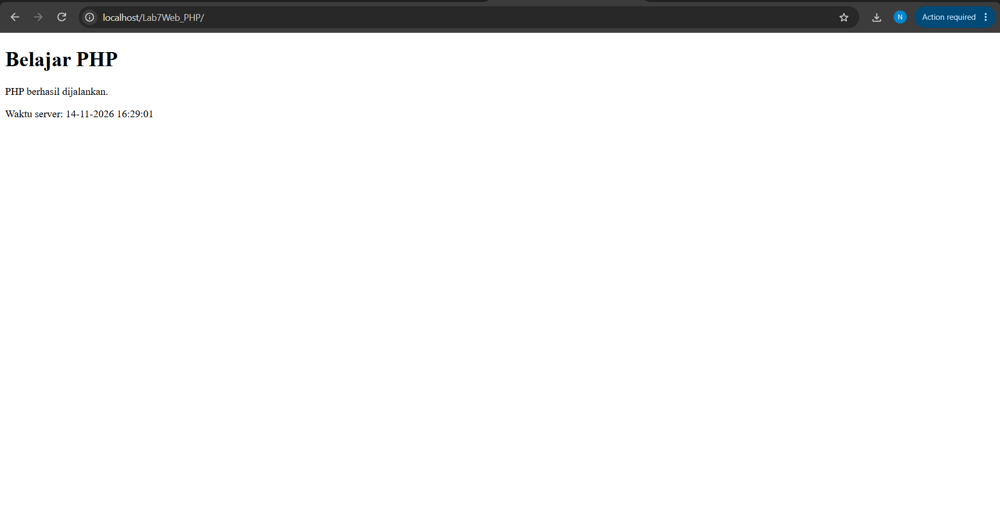

### 2. LATIHAN 2 – VARIABEL, OPERATOR, DAN PERCABANGAN

Pada latihan kedua, digunakan variabel untuk menyimpan nama mahasiswa, nilai tugas, UTS, dan UAS. Selanjutnya dilakukan perhitungan nilai akhir menggunakan operator aritmetika dan menentukan predikat menggunakan percabangan `if`, `elseif`, dan `else`.

**Hasil:** Program berhasil menghitung nilai akhir sebesar 84,60 dan menghasilkan predikat B.

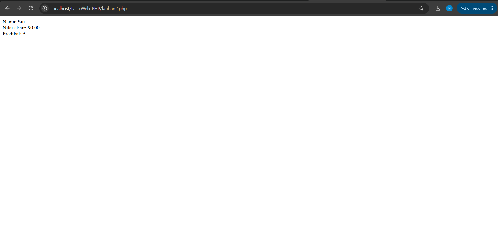

### 3. LATIHAN 3 – ARRAY DAN PERULANGAN

Pada latihan ketiga, dibuat array yang berisi beberapa nama mahasiswa. Data kemudian ditampilkan menggunakan perulangan `foreach`.

**Hasil:** Daftar nama mahasiswa berhasil ditampilkan pada browser.

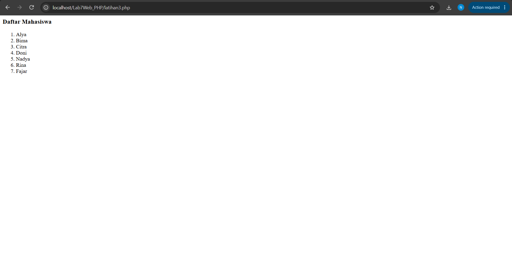

### 4. LATIHAN 4 – MEMBUAT FUNCTION

Pada latihan keempat, dibuat function untuk menghitung harga setelah diskon dan function tambahan untuk menghitung luas persegi panjang.

**Hasil:** Function berhasil dijalankan. Harga setelah diskon sebesar Rp135.000 dan luas persegi panjang sebesar 32.

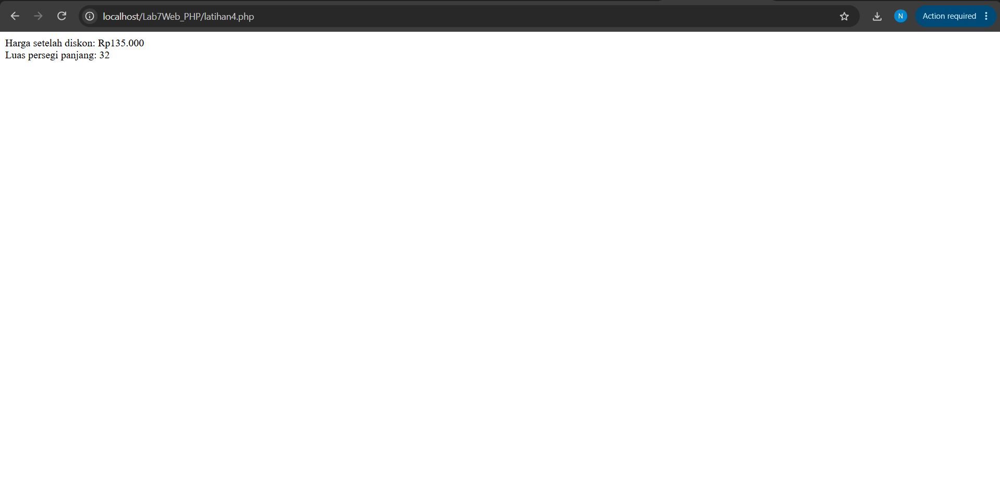

### 5. LATIHAN 5 – MEMPROSES FORM DENGAN GET

Pada latihan kelima, dibuat form pencarian sederhana menggunakan metode GET. Data yang dimasukkan pengguna diterima melalui `$_GET` dan ditampilkan menggunakan `htmlspecialchars()`.

**Hasil:** Kata kunci berhasil diterima dan ditampilkan. Perubahan parameter juga dapat diamati melalui URL browser.

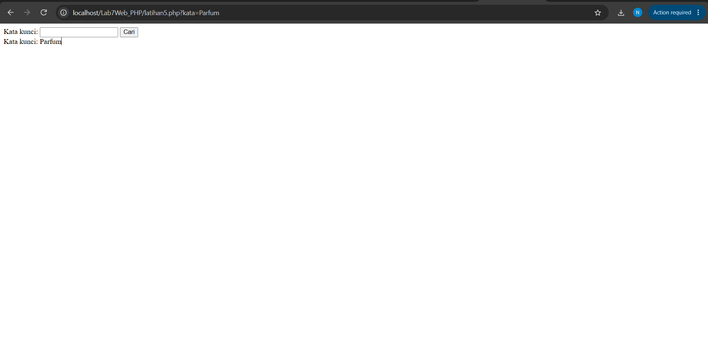

### 6. LATIHAN 6 – MEMPROSES FORM DENGAN POST

Pada latihan keenam, dibuat form yang berisi nama dan program studi menggunakan metode POST. Program melakukan pemeriksaan input sebelum menampilkan data.

**Hasil:** Data berhasil dikirim dan ditampilkan ketika seluruh kolom diisi.

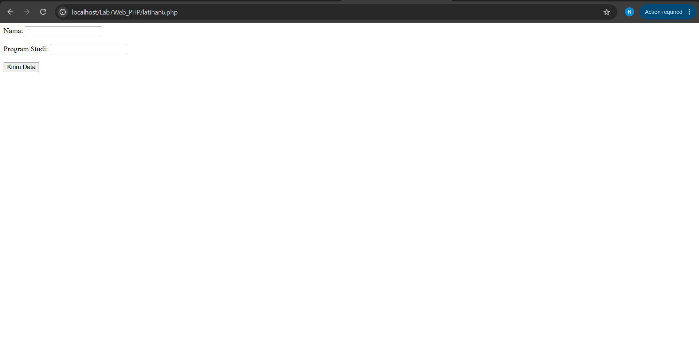

**Pengujian pengiriman data:**

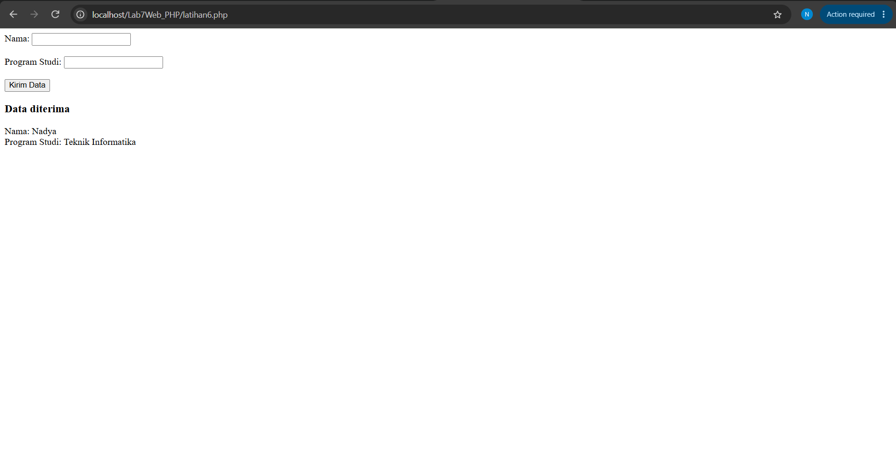

**Pengujian karakter input dan keamanan output:**

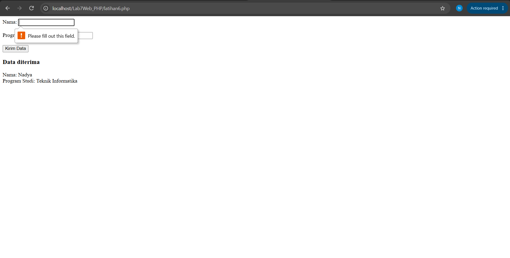

### 7. LATIHAN 7 – PENGOLAHAN DATA SEDERHANA

Pada latihan ketujuh, dibuat form untuk memasukkan nama barang, harga, dan jumlah. PHP digunakan untuk melakukan validasi input dan menghitung subtotal transaksi.

**Hasil:** Program berhasil menghitung subtotal berdasarkan harga dan jumlah barang.

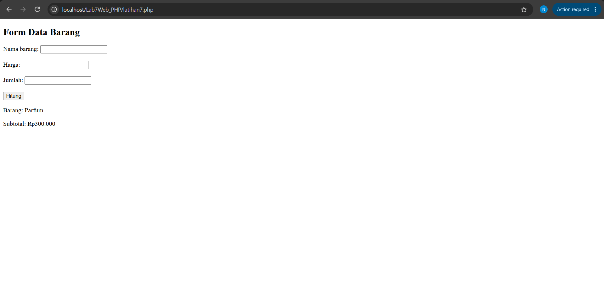

**Pengujian validasi input:**

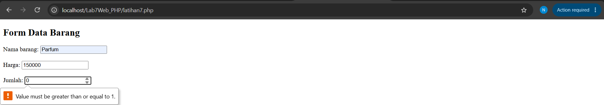

## F. MINI PROJECT – FORM DATA MAHASISWA

Mini project dibuat untuk menerapkan materi PHP yang telah dipelajari. Form berisi nama, NIM, program studi, semester, dan email.

Data dikirim menggunakan metode POST. Program melakukan validasi terhadap kolom wajib, format email, serta semester sebelum menampilkan ringkasan data mahasiswa.

**Hasil pengisian data valid:**

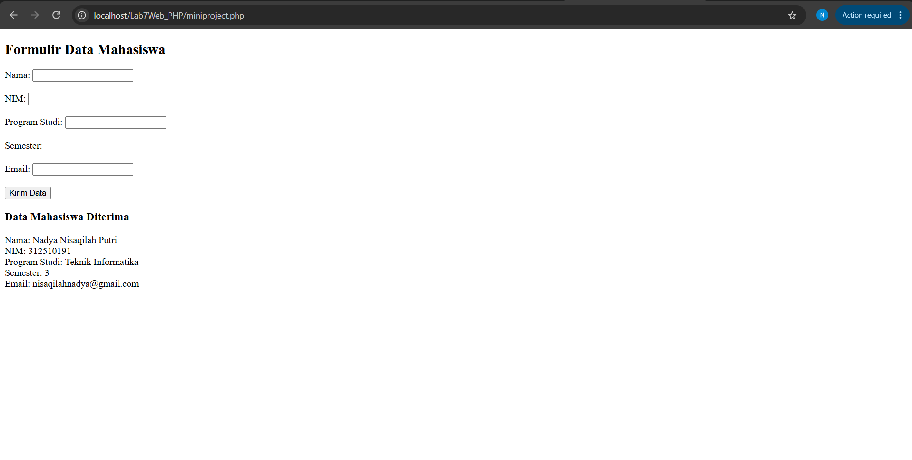

**Pengujian input tidak valid:**

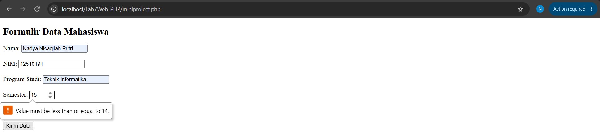

## G. EKSPERIMEN MANDIRI

### 1. EKSPERIMEN 1 – PERHITUNGAN NILAI RATA-RATA

Menambahkan perhitungan nilai rata-rata dari tiga komponen nilai menggunakan operasi aritmetika.

**Hasil:** Program dapat menghitung nilai rata-rata berdasarkan tiga komponen nilai.

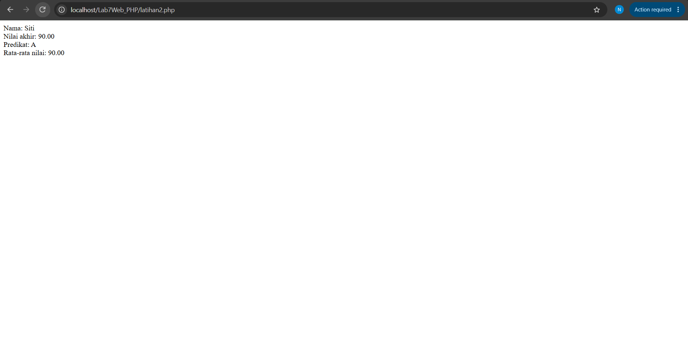

### 2. EKSPERIMEN 2 – PENCARIAN NAMA MENGGUNAKAN GET

Mengembangkan form GET agar dapat mencari nama dari array data sederhana.

**Hasil:** Program dapat menerima kata kunci dan melakukan pencarian nama.

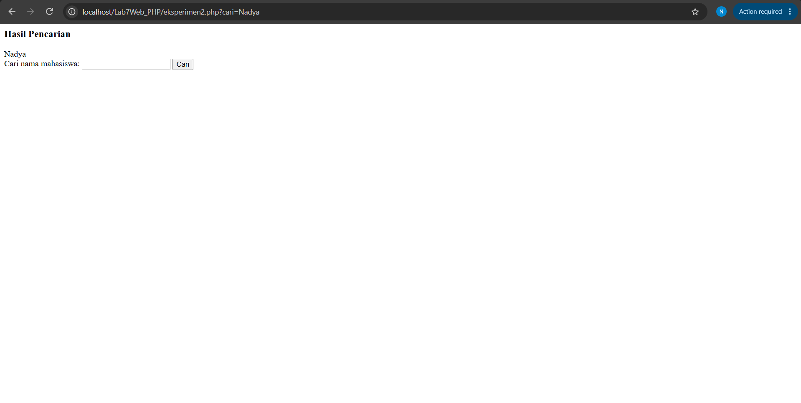

### 3. EKSPERIMEN 2.1 – PENGUJIAN PENCARIAN NAMA

Melakukan pengujian tambahan pada fitur pencarian nama berdasarkan kata kunci yang dimasukkan.

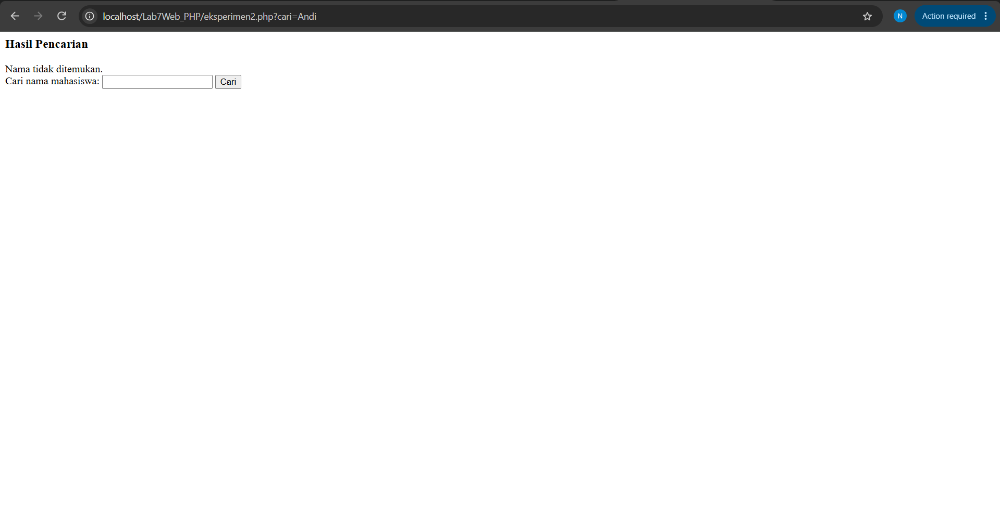

### 4. EKSPERIMEN 3 – FUNCTION FORMAT RUPIAH

Membuat function tambahan untuk mengubah format angka menjadi format mata uang Rupiah agar lebih mudah dibaca.

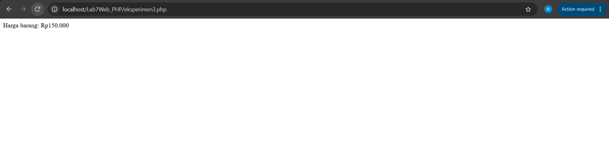

### 5. EKSPERIMEN 4 – VALIDASI NIM

Menambahkan validasi agar NIM hanya berisi angka dan memiliki panjang sesuai ketentuan yang ditetapkan.

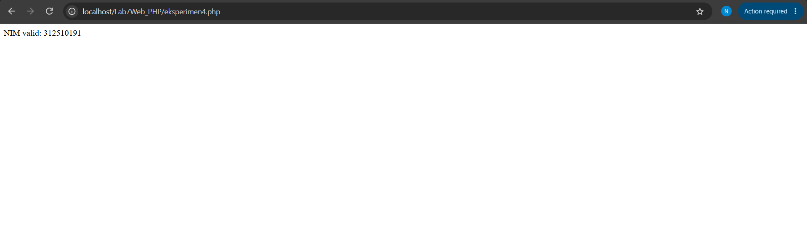

### 6. EKSPERIMEN 5 – TOMBOL RESET FORM

Menambahkan tombol reset untuk menghapus kembali data yang telah dimasukkan pada form. Eksperimen ini juga mengamati perbedaan reset form dengan pemrosesan ulang di server.

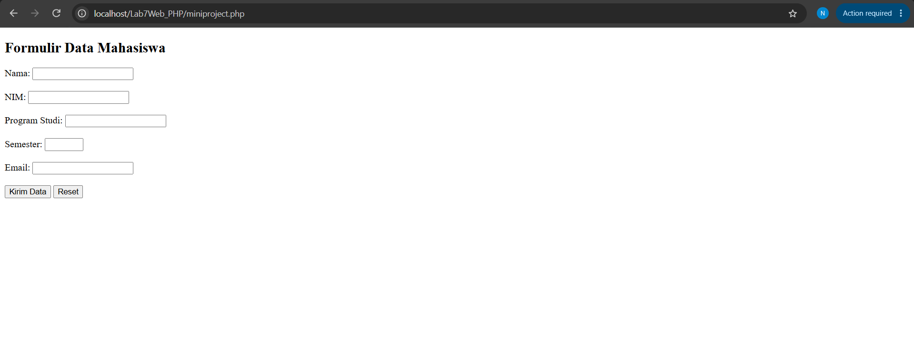

## H. PENGUJIAN INPUT DAN VALIDASI

Pengujian dilakukan untuk memastikan program dapat menerima input yang benar dan menolak input yang tidak sesuai ketentuan.

### 1. INPUT VALID

**Pengujian pertama:**
Mengisi nama dan program studi pada form POST dengan benar sehingga data berhasil diterima dan ditampilkan.

**Pengujian kedua:**
Mengisi nama barang, harga berupa angka, dan jumlah minimal 1 sehingga subtotal berhasil dihitung.

### 2. INPUT TIDAK VALID

**Pengujian pertama:**
Mengosongkan kolom wajib pada form sehingga sistem menolak input atau menampilkan pesan validasi.

**Pengujian kedua:**
Memasukkan jumlah barang 0 atau data yang tidak sesuai ketentuan sehingga sistem menampilkan pesan kesalahan.

### 3. HASIL PENGUJIAN

Berdasarkan pengujian yang dilakukan, program dapat memproses input yang sesuai ketentuan dan melakukan validasi terhadap input yang tidak sesuai. Penggunaan `htmlspecialchars()` juga diterapkan untuk membantu menampilkan input pengguna secara aman.

## I. KESIMPULAN

Berdasarkan seluruh kegiatan praktikum, PHP dapat digunakan untuk membangun halaman web dinamis dan melakukan pengolahan data pada sisi server.

Melalui latihan, mini project, dan eksperimen mandiri, dapat dipahami penggunaan variabel, operator, percabangan, array, perulangan, function, form GET dan POST, serta validasi dan sanitasi input.

Mini project membantu menerapkan materi yang telah dipelajari ke dalam pembuatan form data mahasiswa sederhana.

Dengan demikian, praktikum ini memberikan pemahaman dasar mengenai penerapan PHP dalam membangun aplikasi web sederhana.

---

**Dokumentasi hasil praktikum disimpan dalam folder `screenshot` pada direktori proyek `Lab7Web_PHP`.**
